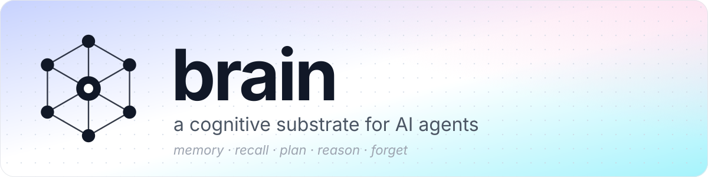

<p align="center">
  
</p>

<p align="center">
  <a href="https://github.com/arc-labs-ai/brain-db/actions/workflows/ci.yml"></a>
  <a href="LICENSE"></a>
  <a href="#project-status"></a>
  <a href="#tech-stack"></a>
  <a href="#platform-support"></a>
  <a href="https://github.com/arc-labs-ai/brain-db/pkgs/container/brain-db"></a>
  <a href="spec/"></a>
</p>

# Brain

**A memory database for AI agents.** One Rust core, one wire protocol, one schema — in place of the vector store + graph store + full-text index + extraction pipeline + consistency glue that an agent stack usually becomes.

Brain stores four record types — **Memory**, **Entity**, **Statement**, **Relation** — with explicit provenance, calibrated confidence, and bi-temporal validity. Retrieval fuses semantic, lexical, and entity-graph lanes through reciprocal rank fusion, so a recall is ranked by relevance rather than by cosine distance alone. Apache 2.0, end to end.

```text
$ brain-server --config config/dev.toml
─────────────────────────────────────────────────────────────────────────────
  ◉ brain-server  v0.4.0  ·  listening 127.0.0.1:9090 (wire) · :9092 (admin)
  ◉ shard 0 ready  ·  WAL synced  ·  HNSW warm  ·  credential store open
  ◉ schema: brain:core + acme:sales (2 namespaces, 14 types)
─────────────────────────────────────────────────────────────────────────────
```

```text
# This repo ships the database, not a client. Any language can speak the
# binary wire protocol (§04) directly — CBOR payloads, 158 opcodes, raw
# little-endian f32 vector trailers. First-party SDKs live in brain-sdk.
# Conceptually:

ENCODE  "Had a difficult conversation with Alex about the project"
  → ENCODED                                  lsn 1 · shard 0/slot 1/v1 ·  9 ms
  → the memory is searchable the moment this ack returns

RECALL  "conflicts with Alex"  top_k=5
  → ranked by semantic similarity, lexical overlap, entity-graph proximity,
    recency and salience — fused, not concatenated

RECALL  "what's Priya working on?"
  → entity-anchored: the typed graph is always live, and declaring your own
    entity and relation types widens it to your vocabulary
```

---

## Table of contents

- [Why Brain](#why-brain)
- [Quickstart](#quickstart)
- [What Brain stores](#what-brain-stores)
- [Tenancy](#tenancy)
- [Schema is always on](#schema-is-always-on)
- [Credentials: BYOK only](#credentials-byok-only)
- [Cognitive operations](#cognitive-operations)
- [Architecture](#architecture)
- [Performance targets](#performance-targets)
- [Security](#security)
- [Project status](#project-status)
- [Known limitations](#known-limitations)
- [Documentation](#documentation)
- [Repository layout](#repository-layout)
- [Tech stack](#tech-stack)
- [Platform support](#platform-support)
- [Contributing](#contributing)
- [Getting help](#getting-help)
- [License](#license)

---

## Why Brain

Today's agent stacks duct-tape four or five storage systems together: a vector database for similarity, a graph database for relationships, a full-text store for keyword matching, an LLM extraction pipeline, plus an orchestration layer that pretends to keep them consistent. Half of that orchestration is reinventing transaction semantics across systems that don't agree on what "committed" means.

Brain collapses the stack into one process:

- **Cognitive verbs, not CRUD.** `ENCODE` / `RECALL` / `PLAN` / `REASON` / `FORGET` are the primitives. The database knows what a memory is, not just what a row is.
- **Fused retrieval out of the box.** Three retrievers — semantic (HNSW), lexical (BM25), entity-graph — combined by reciprocal rank fusion. Not "top-k by cosine."
- **Provenance is first-class.** Every typed claim carries an evidence list back to the source memories, plus four bi-temporal timestamps, so you can answer *when did we learn this* separately from *when was it true*.
- **Extraction is built in, not bolted on.** A three-tier pipeline (pattern → GLiNER classifier → LLM) turns raw memories into entities, statements and relations on the write path. Both models ship inside the image.
- **Predictable tail latency.** Thread-per-core (Glommio + `io_uring`), single writer per shard, lock-free reads, group-commit WAL with `O_DIRECT`.
- **Tenant isolation is structural.** A space is a hard wall: the space is stamped on the row by the authenticated key, never named by the request, and its id is derived non-invertibly from the namespace. Not a `WHERE` clause you can forget.
- **Apache 2.0, end to end.** No premium edition, no SaaS-only features. The typed graph, extractor pipeline, reranker and schema DSL are all in this repo.

The architectural justification, the design wedges, and the comparison with adjacent systems (Pinecone, Qdrant, Neo4j, Mem0, Letta, Zep) are in [`spec/01_architecture/`](spec/01_architecture/00_purpose.md).

---

## Quickstart

### Run the published image

No checkout, no build, no model download — both models are baked into the image.

```bash
docker run -d --name brain \
  -p 8080:8080 -p 9091:9091 \
  --security-opt seccomp=unconfined --ulimit memlock=-1 \
  -e BRAIN__ADMIN__TOKEN="$(openssl rand -hex 32)" \
  -v brain-data:/var/lib/brain/data \
  ghcr.io/arc-labs-ai/brain-db:0.4.0
```

```bash
curl -fsS http://127.0.0.1:9091/healthz   # liveness
curl -fsS http://127.0.0.1:9091/readyz    # 200 once every shard serves
```

Nothing about an LLM is required to boot: `brain-db` starts standalone with an
empty credential store, and a namespace registers its own provider key when it
has one. See [BYOK only](#credentials-byok-only).

| Port | Surface | Expose? |
|---|---|---|
| **8080** | Data plane — binary wire protocol (CBOR). SDKs connect here. | yes |
| **9091** | Public HTTP — `/healthz`, `/readyz`, `/metrics`. No auth, no data. | yes |
| **9092** | Admin HTTP — `/v1/*`: key mint/revoke, worker control, audit, snapshots, shard status. | **no** — loopback only |

The data port speaks a binary protocol, not HTTP, so `curl` only reaches the
metrics listener. To `ENCODE` and `RECALL`, connect with
[`brain-sdk`](https://github.com/arc-labs-ai/brain-sdk) (Rust / Python /
TypeScript), explore interactively with
[`brain-shell`](https://github.com/arc-labs-ai/brain-shell), or front it with
[`brain-edge`](https://github.com/arc-labs-ai/brain-edge) for an HTTP/JSON
surface. Reach the admin plane with `docker exec`.

Full operator guide — compose, sizing, upgrade/rollback, backup, minting the
first API key: [`DEPLOY.md`](DEPLOY.md).

### What ships in the image

Brain has no model-download path and refuses to start without its models on
disk, so both are bundled (~720 MB of the image, no egress at any boot):

| Model | Role | Path |
|---|---|---|
| `bge-small-en-v1.5` (384-dim) | Embeddings for every memory | `/opt/brain/models/bge-small-en-v1.5` |
| `gliner-small-v2.1` | Classifier tier of the extractor pipeline | `/opt/brain/models/gliner-small-v2.1` |

Override either with a mount plus `BRAIN_EMBED_MODEL_DIR` or
`BRAIN__EXTRACTORS__CLASSIFIER__MODEL_PATH`. Changing the embedding model
changes the embedding fingerprint — re-embed, never mix.

### Build from source

For working *on* Brain rather than with it. Brain is Linux-only; on macOS or
Windows the dev container is the supported path.

**Requires:** Docker, [`@devcontainers/cli`](https://github.com/devcontainers/cli) (`npm install -g @devcontainers/cli`).

```bash
git clone https://github.com/arc-labs-ai/brain-db
cd brain-db
just docker-up            # builds image, starts container, runs post-create
just docker-shell         # bash inside the dev container
```

Inside the container:

```bash
just verify                                            # fmt + build + clippy -D warnings + test
cargo run --bin brain-server -- --config config/dev.toml  # no provider key needed

curl -s http://127.0.0.1:9091/healthz                  # liveness (public, no auth)
curl -s http://127.0.0.1:9091/readyz                   # 200 when all shards serve, 503 otherwise
curl -s http://127.0.0.1:9091/metrics | grep '^brain_' # metrics are the stats surface
curl -s -H "Authorization: Bearer dev-admin-token" \
     http://127.0.0.1:9092/v1/shards                   # admin plane ([admin] token in dev.toml)
```

Tests run under [`cargo-nextest`](https://nexte.st) (`just test`); doctests stay
on `cargo test --doc`. Some tests are `#[ignore]`-gated — they need a real
model, a live provider key, or are long/perf gates — and run with
`cargo nextest run --run-ignored all`.

---

## What Brain stores

Four record types, one database:

| Record | What it is | Example |
|---|---|---|
| **Memory** | Raw experience — text + 384-dim embedding + salience + edges + provenance | `"Alex pushed the deadline to next Friday"` |
| **Entity** | Canonical noun with a stable UUIDv7 identity, alias list, and typed attributes | `Person(canonical_name="Alex Chen", aliases=["Alex"])` |
| **Statement** | Typed claim about entities — `Fact` / `Preference` / `Event` — with confidence and bi-temporal validity | `Event(subject=alex, predicate=pushed, object="deadline to Friday", valid_from=t0, confidence=0.92)` |
| **Relation** | Typed binary edge between entities, with cardinality and evidence | `reports_to(alex, priya)` |

Entities, Statements and Relations are **derived from Memories** by the
three-tier extractor pipeline (pattern → GLiNER classifier → LLM with a
response cache). The pipeline runs on every shard; a candidate persists only if
its type is declared in an active schema, and the seeded `brain:` system schema
is always one of them.

The full data model is in [`spec/02_data_model/`](spec/02_data_model/00_purpose.md).

---

## Tenancy

Three levels, and only two of them are boundaries:

| Level | What it is | Isolation |
|---|---|---|
| **Namespace** | The tenant. Owns schemas, credentials and spaces. | **Hard wall.** Nothing crosses it. |
| **Space** | The isolation unit a key is bound to — one agent, one user, one workspace. | **Hard wall.** Every row carries its owning space, every listing index is space-prefixed, and a space's data lives on exactly one shard. |
| **Session** | A soft grouping inside a space — a conversation, a run, a thread. Client-chosen opaque `u64`; `0` is the default session. | **Not a boundary.** A filter and a grouping key, nothing more. |

A space id is derived, not assigned:

```text
space_id = UUIDv5( UUIDv5(BRAIN_ROOT_NAMESPACE_UUID, namespace), space_string )
```

Folding the namespace into the seed means the same space string under two
namespaces lands on two disjoint ids, so isolation holds at the identifier
level and not only at the row-scope prefix. The derivation is non-invertible
and frozen — pinned by a golden test, because changing it would re-key every
space in every deployment.

A space lives on exactly one shard: `shard = BLAKE3(space_id)[..8] % shard_count`.
That is what makes per-shard linearizability enough — all of one space's
operations are ordered with respect to each other.

**Identity is never client-claimed.** A connection presents an API key at
handshake; the server hashes it (`BLAKE3(secret)`) and reads the
`(namespace, space, permissions)` scope out of the key's own record. A request
cannot name the space it writes to.

The one exception is deliberate and gated: a trusted service principal — an
edge or gateway fronting many tenants — may carry the `ACT_AS` permission and
set a per-request `act_as { namespace, space, grant }` on tenant-scoped
requests. Brain honors it only when the target namespace is in that key's
`may_act` allowlist, the delegated grant is bounded by what the delegator
itself holds, and a delegated operation can never itself delegate. Anything
else is rejected with `ActAsDenied`. Ordinary space keys never hold this bit.

Details: [`spec/20_tenancy/`](spec/20_tenancy/00_purpose.md).

---

## Schema is always on

Schema is not a mode you switch into — it is active from byte zero. Every shard
seeds the reserved `brain:` system namespace, so the full pipeline (typed
extraction, entity/statement/relation writes, entity-anchored retrieval) runs on
every deployment. There is no memory-only mode and no runtime gate that turns
the typed graph on.

What a schema controls is **admission**, not activation. A write — explicit or
extractor-driven — persists a typed row only if its entity type, predicate or
relation type is declared in some active schema. Declaring your **own** types is
optional and purely additive: `SCHEMA_UPLOAD` merges your declarations into the
active set, widening what gets admitted and enabling typed queries over your
vocabulary. It never gates a retrieval, extraction or index path.

| Posture | What persists | Use it when |
|---|---|---|
| **System schema only** (default) | Extraction runs; only candidates matching the seeded `brain:` types are admitted. Everything stays recallable as memory. | Prototyping; semantic memory without a domain vocabulary; small agents. |
| **Your types declared** | The above, plus your entity / statement / relation types, so extraction persists domain rows and entity-anchored queries range over your graph. | Production agents needing provenance, temporal reasoning, supersession, or typed queries. |

Declaring types later is fine — a declaration after months of use kicks off a
backfill over already-stored memories.

The DSL is documented in [`spec/03_schema/`](spec/03_schema/00_purpose.md):

```text
namespace acme

define entity_type Person {
    attributes {
        email:    text optional unique
        team:     text optional
        timezone: text optional
    }
}

define predicate prefers {
    kind:   Preference
    object: Value<text>
}

define relation_type reports_to {
    from:        Person
    to:          Person
    cardinality: many-to-one
}

define extractor preferences {
    kind:                 llm
    target:               statement Preference
    trigger:              on encode where memory.kind = episodic
    model:                "gpt-4o-mini"
    confidence_threshold: 0.7
    cache:                enabled
}
```

---

## Credentials: BYOK only

**A deployment holds no provider credential of its own.** A key registered by
a namespace is the only way an LLM call is paid for, and there is no second
path — no `[llm] api_key`, no `OPENAI_API_KEY` gate, nothing to set.

- A namespace registers its own key over the wire (`LLM_CREDENTIAL_PUT`). Brain
  seals it and opens it only for the duration of an outbound provider call, so
  extraction, HyPE and entity disambiguation all bill the tenant that owns the
  memory being processed.
- The sealing key is generated into the data directory on first boot, so a
  fresh install seals with no configuration. That protects a copied volume or a
  backup archive, because neither carries the key file — it does **not** protect
  someone holding the whole data directory. Set
  `BRAIN__LLM__CREDENTIALS__KEK` to keep the sealing key off Brain's disk.
- A plaintext key only travels a TLS, mTLS or loopback connection; a
  registration over anything else is refused.

Nothing gates boot on a credential, so `brain-db` starts standalone with an
empty store. **Registering a key is the first thing a tenant does**, though:
HyPE and extraction both need one, so a namespace with no key has its writes
refused with `LlmCredentialMissing` rather than storing text Brain cannot
ground. A key that is merely unreachable is the softer case — the write lands
and the stage reports why it could not run.

Brain's own minted API keys are a different object entirely: they authenticate
clients *to* Brain, and the database stores only `BLAKE3(secret)` — never the
secret itself.

Normative text: [`spec/11_extractors/00_purpose.md`](spec/11_extractors/00_purpose.md) and [`spec/20_tenancy/00_purpose.md`](spec/20_tenancy/00_purpose.md) §3.1.

---

## Cognitive operations

The verbs that drive Brain. Full semantics in [`spec/05_operations/`](spec/05_operations/00_purpose.md).

| Verb | What it does |
|---|---|
| **ENCODE** | Store an experience. Embeds the text, reserves a slot, fsyncs the WAL record, commits metadata and inserts into HNSW — then queues the derivation stages. |
| **RECALL** | Find memories relevant to a cue. Fans out to the semantic, lexical and graph retrievers and fuses them by RRF — one read path. Entity-anchored cues additionally enrich from the typed graph. |
| **PLAN** | Construct a path from one cognitive state to another. Pull-based executor with budgets (steps, wall time, branches). |
| **REASON** | Multi-hop traversal explaining why X is connected to Y. Returns the path, the evidence memories, and a confidence. |
| **FORGET** | Soft (mark + grace period) or hard (zero the slot) tombstoning. Cascades to derived typed-graph rows. |
| **LINK** / **UNLINK** | Manually assert or retract a typed edge between two memories. |
| `ENTITY_*` / `STATEMENT_*` / `RELATION_*` | Typed-graph reads and writes — get, list, create, supersede, retract, traverse — each carrying its evidence. `GRAPH_FETCH` pages out the whole graph. |
| **SUBSCRIBE** | Stream events: memory created, stage completed, statement created, schema updated, extractor failed. |
| **TXN_BEGIN** / **TXN_COMMIT** / **TXN_ABORT** | Group operations into one atomic unit, with read-your-writes inside it. |

### A write is synchronous; its derivations are not

`ENCODE` returns on the durable ack — WAL fsynced, metadata committed, vector
in the index. **The memory is searchable the moment that ack returns**: the
HNSW insert happens inside the write submission, and a freshly-inserted vector
is served from a pending buffer at exact cosine until a later flush folds it
into the main graph. There is no publication lag to wait out and no consistency
flag to set.

What *is* eventual is everything derived from the write — auto-edges, temporal
edges, causal edges, extraction, HyPE questions, and the lexical index's group
commit. Each announces itself, so a caller waits for the stage it actually
depends on:

```text
ENCODE text wait=ack       # default — returns on the durable ack
  → SUBSCRIBE memory_ids=[id] → StageCompleted(AutoEdge | TemporalEdge | Extractor | Hype)

ENCODE text wait=derived   # or take the whole derivation timeline in the response
  → trace.stages: per-stage status, latency and artifacts
```

`wait=derived` is bounded by the shard's trace drain window, so a stalled worker
can't hang the call. Encoding the same content twice is a no-op by default;
`ENCODE` and `FORGET` are idempotent on `request_id`.

Consistency model in full: [`spec/05_operations/07_consistency.md`](spec/05_operations/07_consistency.md).

---

## Architecture

```
┌─────────────────────────────────────────────────────────────────────────────┐
│            CLIENTS (any language — speak the wire protocol directly)        │
└────────────────────────────────────┬────────────────────────────────────────┘
                                     │ binary protocol over TCP (optional TLS 1.3)
                                     │ CBOR payloads + raw LE-f32 vector trailer
┌────────────────────────────────────▼────────────────────────────────────────┐
│  CONNECTION LAYER · Tokio · accept · TLS · frame validate · shard dispatch   │
└────────────────────────────────────┬────────────────────────────────────────┘
                                     │ message channels, one per shard
                ┌────────────────────┼────────────────────┐
                ▼                    ▼                    ▼
        ┌──────────────┐     ┌──────────────┐     ┌──────────────┐
        │  Shard 0     │     │  Shard 1     │     │  Shard N     │
        │  Glommio +   │     │  Glommio +   │     │  Glommio +   │
        │  io_uring    │     │  io_uring    │     │  io_uring    │
        │              │     │              │     │              │
        │  ┌────────┐  │     │  ┌────────┐  │     │  ┌────────┐  │
        │  │ arena  │  │     │  │ arena  │  │     │  │ arena  │  │
        │  │ WAL    │  │     │  │ WAL    │  │     │  │ WAL    │  │
        │  │ redb   │  │     │  │ redb   │  │     │  │ redb   │  │
        │  │ HNSW×5 │  │     │  │ HNSW×5 │  │     │  │ HNSW×5 │  │
        │  │ tantvy │  │     │  │ tantvy │  │     │  │ tantvy │  │
        │  └────────┘  │     │  └────────┘  │     │  └────────┘  │
        │              │     │              │     │              │
        │ Single writer per shard. Lock-free reads via ArcSwap + crossbeam.   │
        └──────┬───────┘     └──────┬───────┘     └──────┬───────┘
               │                    │                    │
               └────────────────────┼────────────────────┘
                                    ▼
                    BACKGROUND WORKERS (per-shard, dedicated cores)
                    auto-edge · temporal-edge · causal-edge · extractors
                    decay · consolidation · HNSW maintenance · text indexer
                    snapshots · GC · sweepers
```

**Two runtimes, one host.** The connection layer runs on Tokio — many tasks,
accept TCP, decode the 32-byte frame header, dispatch. The shard layer runs on
Glommio — thread-per-core, `io_uring`, one writer per shard. They communicate
over channels carrying messages; per-shard data never crosses the boundary.

**Per-shard data structures:**

| Structure | Role | Spec |
|---|---|---|
| Arena | mmap'd file of 1600-byte slots (1536-byte vector + 64 metadata) | [`spec/08_storage/01_arena.md`](spec/08_storage/01_arena.md) |
| WAL | Append-only log; `O_DIRECT` + `pwritev2(RWF_DSYNC)` group commit | [`spec/08_storage/02_wal.md`](spec/08_storage/02_wal.md) |
| redb | Embedded ACID B-tree for metadata + typed-graph tables | [`spec/10_metadata/02_table_layout.md`](spec/10_metadata/02_table_layout.md) |
| HNSW × 5 | Memory `M=16, ef_c=200, ef_s=64` · Entity `M=16, ef_c=100, ef_s=64` · Statement `M=32, ef_c=200, ef_s=128` · HyPE questions · statement-question bridge | [`spec/09_indexing/01_hnsw_basics.md`](spec/09_indexing/01_hnsw_basics.md) |
| tantivy × 2 | BM25 over memory text and over statement text | [`spec/10_metadata/06_tantivy_layout.md`](spec/10_metadata/06_tantivy_layout.md) |
| LLM cache | Separate redb for extractor and HyPE responses, with TTL | [`spec/11_extractors/06_prompt_caching.md`](spec/11_extractors/06_prompt_caching.md) |

**Seven non-negotiable invariants** (from [`spec/08_storage/00_purpose.md`](spec/08_storage/00_purpose.md)):

1. **WAL-before-acknowledge** — no operation returns success until its WAL record is fsynced.
2. **Single writer per shard** — no locks needed; the discipline enforces it.
3. **CRC everywhere** — every WAL record, every arena slot. Reads verify; mismatches halt.
4. **Slot version in the `MemoryId`** — the id packs `(shard, slot, version)`, so a stale reference resolves to `NotFound`, never to someone else's data.
5. **Idempotency by `RequestId`** — same params return the cached response; different params return `Conflict`.
6. **Tombstone grace before reclamation** — 7 days by default. A hard `FORGET` zeroes immediately.
7. **No silent corruption** — fail-stop and alert. Never return wrong data.

Verified per [`spec/19_benchmarks/01_correctness_and_durability.md`](spec/19_benchmarks/01_correctness_and_durability.md).

For the seven internal layers (L1 connection through L7 sharding) and the design
wedges, see [`spec/01_architecture/04_layers.md`](spec/01_architecture/04_layers.md)
and [`spec/01_architecture/07_wedges_and_roadmap.md`](spec/01_architecture/07_wedges_and_roadmap.md).

---

## Performance targets

Hard targets from [`spec/01_architecture/05_hardware_and_targets.md`](spec/01_architecture/05_hardware_and_targets.md) §7
and [`spec/19_benchmarks/02_performance_targets.md`](spec/19_benchmarks/02_performance_targets.md).
Single shard, warm, reference hardware (16-core x86_64 / 64 GB RAM / NVMe SSD):

| Operation | p50 | p99 |
|---|---|---|
| `ENCODE` (text, CPU embedding) | ≤ 12 ms | ≤ 25 ms |
| `ENCODE` (text, GPU embedding) | ≤ 3 ms | ≤ 8 ms |
| `ENCODE_VECTOR_DIRECT` (pre-supplied vector) | ≤ 1 ms | ≤ 5 ms |
| `RECALL` (top-k = 10, no text payload) | ≤ 5 ms | ≤ 20 ms |
| `RECALL` (top-k = 10, with text payload) | ≤ 7 ms | ≤ 30 ms |
| `FORGET` | ≤ 3 ms | ≤ 10 ms |
| `PLAN` (simple) | ≤ 50 ms | ≤ 200 ms |
| `REASON` | ≤ 100 ms | ≤ 500 ms |

Brain optimizes for predictable tails, not minimum averages.

> **These are targets, not measurements.** They have not yet been captured on
> reference hardware; see [`ROADMAP.md`](ROADMAP.md#performance-verification).
> The in-crate criterion benches run at 10K-corpus scale in CI.

---

## Security

- **Authentication is mandatory and fail-closed.** Every data-plane connection
  must present a valid, resolvable, non-revoked API key. There is no anonymous
  mode and no config knob to disable it.
- **Keys are stored as `BLAKE3(secret)`.** The plaintext secret never touches
  disk. Permissions are a bitfield — `ENCODE`, `RECALL`, `FORGET`, `LINK`,
  `SCHEMA_UPLOAD`, `ADMIN`, `ACT_AS`.
- **The admin plane needs its own bootstrap secret.** `[admin] token` /
  `BRAIN__ADMIN__TOKEN` gates every `/v1/*` call as `Authorization: Bearer`. If
  it is unset the server refuses to start rather than come up unauthenticated.
- **No tenant credential ever enters the database.** See [BYOK only](#credentials-byok-only).
- **Wire TLS is opt-in, and TLS 1.3 only when on.** `[tls] enabled` defaults to
  `false` — fine inside a container or on a trusted LAN, not fine across an
  untrusted network. When enabled it is rustls with `aws-lc-rs`; TLS 1.2 is
  compiled out, so there is no downgrade to negotiate.

The admin plane stays on loopback by design — front it with your own
token/mTLS proxy rather than publishing port 9092. Taking the data plane beyond
a trusted network means turning on wire TLS and working through the hardening
runbook in [`SECURITY.md`](SECURITY.md#production-deployment-hardening), which
also carries the threat model.

**Report vulnerabilities privately**, never as a public issue:
[`SECURITY.md`](SECURITY.md#reporting-a-vulnerability).

---

## Project status

**Pre-release — v0.4.0.** The wire protocol, redb table layouts and schema model
are still in flux. Until v1.0 ships, breaking changes happen **in place**: no
back-compat shims, no aliases, no migration paths. Pin an exact image tag (or a
digest) and read [`CHANGELOG.md`](CHANGELOG.md) before upgrading.

v1.0 ships when the combined acceptance suite passes — functional, storage,
operational and durability, end to end
([`spec/19_benchmarks/06_complete_acceptance.md`](spec/19_benchmarks/06_complete_acceptance.md)).

Planned work, deferred verification and larger architectural directions are
tracked in [`ROADMAP.md`](ROADMAP.md). Nothing there is a commitment or a date.

**The spec is the contract.** [`spec/`](spec/) — 149 files across 21 sections —
is normative; where the code and the spec disagree, the code is wrong. Drift
tests in `crates/brain-protocol/tests/` fail CI if the opcode and error tables
in the spec stop matching the enums in the code.

---

## Known limitations

Scope boundaries, listed so they aren't mistaken for bugs.

- **Single-node only, no replication.** Node loss means restore-from-snapshot. Full backup/restore is over the admin HTTP plane (`/v1/snapshots`); the periodic background snapshot worker captures the HNSW graph only, not a full bundle.
- **Linux only.** Glommio and `io_uring` don't run elsewhere.
- **English text only.** `bge-small-en-v1.5` is an English model; multilingual support needs a different embedder and a full re-embed.
- **One embedding model per deployment, pinned at creation.** There is no in-place migration — `ADMIN_MIGRATE_EMBEDDINGS` is a reserved opcode with no handler. Changing models means a fresh deployment and a re-ingest.
- **Cross-encoder rerank is not available in this release.** `[rerank]` ships `enabled = false` and the image carries no cross-encoder model; opt-in rerank requests return `CapabilityNotEnabled` and `GET_CAPABILITIES` reports `rerank: false`. Retrieval fuses with RRF alone.
- **The consolidation summarizer is off by default.** `[summarizer] backend = "disabled"`; a real backend needs the `summarizer-llm` build feature (which bills each tenant's own registered credential) or `summarizer-ollama` (a locally hosted model).
- **No query language.** The wire protocol is typed RPC. A SQL-like text language would be a separate, much larger effort.
- **No client in this repo.** Brain's public interface is the §04 wire protocol. Clients ship separately: [`brain-sdk`](https://github.com/arc-labs-ai/brain-sdk) (Rust / Python / TypeScript), [`brain-shell`](https://github.com/arc-labs-ai/brain-shell) (REPL), [`brain-edge`](https://github.com/arc-labs-ai/brain-edge) (HTTP/JSON).
- **Fine-grained access control is out of scope.** Brain has authentication and space-level authorization; per-memory ACLs, field-level security and time-bounded permissions are not built.
- **Recall does not resolve supersession.** Memories rank by relevance, so a superseded claim can still outrank the statement that replaced it. Supersession is modelled on statements, not on raw memories.
- **Entity GC tombstones but does not hard-reclaim.** `EntityGc` is a real per-shard worker, off by default (daily, 30-day grace). Enabled, it tombstones truly-orphaned entities with an audit row; physical reclamation rides the existing tombstone-grace flow.
- **`SUBSCRIBE`'s similarity filter has no initial snapshot.** A `similar_to` subscription gates live events on cosine similarity to a reference memory, but `include_history` applies the other filters only.
- **Plain `RECALL` is memory-only by design.** The statement HNSW is searched for typed-graph `QUERY` and entity-anchored `RECALL`; a non-anchored recall projects memory hits, so statement candidates there would be pure overhead.
- **Slot reuse isn't on the live path.** The writer mints slots from a `next_slot` atomic; the free-list allocator is implemented and exercised by recovery but not yet wired into the write path. Slot *versioning* is enforced regardless, via the `MemoryId` encoding.

---

## Documentation

| Topic | Location |
|---|---|
| Guides, SDK reference, self-hosting | **[docs.arc-labs.ai](https://docs.arc-labs.ai)** |
| Try it in the browser — no install | **[playground.arc-labs.ai](https://playground.arc-labs.ai)** |
| Deploying and operating Brain | [`DEPLOY.md`](DEPLOY.md) |
| Security policy, threat model, hardening | [`SECURITY.md`](SECURITY.md) |
| Release history | [`CHANGELOG.md`](CHANGELOG.md) |
| Planned work and future directions | [`ROADMAP.md`](ROADMAP.md) |
| How to contribute | [`CONTRIBUTING.md`](CONTRIBUTING.md) · [`CODE_OF_CONDUCT.md`](CODE_OF_CONDUCT.md) |
| **Specification** (149 files, 21 sections, normative) | [`spec/`](spec/) |
| Spec entry point + glossary + doc map | [`spec/00_overview/`](spec/00_overview/00_index.md) |
| System architecture + design wedges | [`spec/01_architecture/`](spec/01_architecture/00_purpose.md) |
| Data model (Memory / Entity / Statement / Relation) | [`spec/02_data_model/`](spec/02_data_model/00_purpose.md) |
| Schema DSL grammar | [`spec/03_schema/`](spec/03_schema/00_purpose.md) |
| Wire protocol (frames, 158 opcodes, handshake) | [`spec/04_wire_protocol/`](spec/04_wire_protocol/00_purpose.md) |
| Tenancy and isolation | [`spec/20_tenancy/`](spec/20_tenancy/00_purpose.md) |
| Acceptance gate for v1.0 | [`spec/19_benchmarks/06_complete_acceptance.md`](spec/19_benchmarks/06_complete_acceptance.md) |
| Client SDKs (Rust / Python / TS) + interactive shell | [`brain-sdk`](https://github.com/arc-labs-ai/brain-sdk), [`brain-shell`](https://github.com/arc-labs-ai/brain-shell) |
| Evaluation, perf/scale, soak and acceptance harness | [`brain-eval`](https://github.com/arc-labs-ai/brain-eval) |

---

## Repository layout

```
brain/
├── crates/
│   ├── brain-core/         Shared types: MemoryId, SpaceId, SessionId, EdgeKind, Error
│   ├── brain-protocol/     Wire protocol: frames, 158 opcodes, codec, schema DSL parser
│   ├── brain-storage/      Arena + WAL + recovery
│   ├── brain-metadata/     redb wrapper: memory, entity, statement, relation, registry tables
│   ├── brain-index/        HNSW × 5 + tantivy × 2 + retrievers
│   ├── brain-embed/        BGE embedding service
│   ├── brain-rerank/       Cross-encoder reranker (off by default)
│   ├── brain-planner/      Query planner + executor
│   ├── brain-ops/          One write path + retrievers + extractor writes
│   ├── brain-workers/      Background workers (auto-edge, decay, consolidation, …)
│   ├── brain-extractors/   Pattern + GLiNER classifier extractors
│   ├── brain-llm/          LLM client + credential resolver + cache + budget
│   ├── brain-plugins/      Plugin surface (enricher + connector)
│   ├── brain-http/         HTTP transport for the public and admin listeners
│   └── brain-server/       Server binary
├── config/                 Reference configurations (dev, docker)
├── fuzz/                   cargo-fuzz targets
└── spec/                   The 149-file specification (authoritative)
```

---

## Tech stack

Rust **1.95+** (MSRV, pinned in `Cargo.toml`), edition 2021. Dependency versions
are centralized in the workspace manifest; new dependencies require
commit-message justification.

| Component | Crate |
|---|---|
| Async runtime (shards) | [`glommio`](https://github.com/DataDog/glommio) — thread-per-core, `io_uring` |
| Async runtime (connection layer) | [`tokio`](https://tokio.rs) |
| TLS (opt-in) | [`rustls`](https://github.com/rustls/rustls) with `aws-lc-rs` — TLS 1.3 only |
| Wire encoding | [`ciborium`](https://github.com/enarx/ciborium) (CBOR) + raw little-endian `f32` vectors |
| Internal storage encoding | [`rkyv`](https://github.com/rkyv/rkyv) + [`bytemuck`](https://github.com/Lokathor/bytemuck) |
| Metadata store | [`redb`](https://github.com/cberner/redb) |
| ANN index | [`hnsw_rs`](https://github.com/jean-pierreBoth/hnswlib-rs) |
| Lexical index | [`tantivy`](https://github.com/quickwit-oss/tantivy) |
| Embedding + classifier inference | [`candle`](https://github.com/huggingface/candle) + [`tokenizers`](https://github.com/huggingface/tokenizers) |
| SIMD math | [`matrixmultiply`](https://github.com/bluss/matrixmultiply) + [`wide`](https://github.com/Lokathor/wide) |
| Hashing (keys, routing) | [`blake3`](https://github.com/BLAKE3-team/BLAKE3) |
| Lock-free swap | [`arc-swap`](https://github.com/vorner/arc-swap) |
| Epoch GC | [`crossbeam-epoch`](https://docs.rs/crossbeam-epoch) |
| CRC | [`crc32c`](https://docs.rs/crc32c) |
| UUIDs (v5 + v7) | [`uuid`](https://docs.rs/uuid) |
| Errors | [`thiserror`](https://docs.rs/thiserror) + [`anyhow`](https://docs.rs/anyhow) |
| Telemetry | [`tracing`](https://docs.rs/tracing) + [`opentelemetry`](https://opentelemetry.io) |

---

## Platform support

**Linux only.** Kernel ≥ 5.15, for stable `io_uring`. macOS and Windows are not
supported targets; use the supplied dev container to develop on those hosts.

Brain depends on Linux-specific I/O facilities: `io_uring`, `O_DIRECT`,
`madvise(MADV_RANDOM | MADV_DONTDUMP)`, `fallocate(FALLOC_FL_KEEP_SIZE)`.
Abstracting them would either leak platform differences into tail latency or
bloat the codebase with parallel backends. For a system whose value proposition
*is* latency, one optimized backend wins.

**CPU:** x86_64 with SSE 4.2, or ARM64 with the CRC32 extension. AVX2 and NEON
are used opportunistically. Full hardware envelope in
[`spec/01_architecture/05_hardware_and_targets.md`](spec/01_architecture/05_hardware_and_targets.md).

Running under Docker needs `--security-opt seccomp=unconfined` (the default
profile blocks `io_uring` syscalls) and `--ulimit memlock=-1`.

---

## Contributing

Contributions are welcome. Start with [`CONTRIBUTING.md`](CONTRIBUTING.md) — it
covers the dev-container workflow, the core invariants, test conventions and
commit format. Participation is governed by the
[Code of Conduct](CODE_OF_CONDUCT.md).

Brain is pre-release, so a few rules are stricter than usual:

- **The spec leads the code.** Spec changes go through the project owner; where
  code disagrees with the spec, the code gets fixed.
- **The seven invariants in [`spec/08_storage/00_purpose.md`](spec/08_storage/00_purpose.md) are non-negotiable.**
- **No back-compat shims before v1.0.** Rename everywhere and delete the old
  form — no aliases, no deprecation window.
- **New dependencies require justification** in the commit message.

`just verify` (fmt + build + clippy `-D warnings` + test) is what CI runs; run it
before you push. `.github/workflows/ci.yml` is the authoritative gate.

By submitting a pull request you agree your contribution is licensed under the
Apache-2.0 terms (per Apache-2.0 §5).

---

## Getting help

| | |
|---|---|
| Bugs, feature requests, questions | [GitHub Issues](https://github.com/arc-labs-ai/brain-db/issues) |
| Security vulnerabilities | **Private disclosure only** — see [`SECURITY.md`](SECURITY.md#reporting-a-vulnerability) |
| Guides and SDK reference | [docs.arc-labs.ai](https://docs.arc-labs.ai) |
| Client-side problems | the relevant SDK repo: [`brain-sdk`](https://github.com/arc-labs-ai/brain-sdk), [`brain-shell`](https://github.com/arc-labs-ai/brain-shell), [`brain-edge`](https://github.com/arc-labs-ai/brain-edge) |

A good bug report names the version (or image digest), the platform and kernel,
the config that reproduces it, and the relevant `brain_*` metrics or log lines.

---

## License

[Apache-2.0](LICENSE). Source code, specification and documentation are all
under the same license.

Repository: <https://github.com/arc-labs-ai/brain-db>
